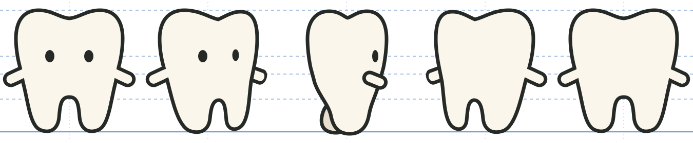
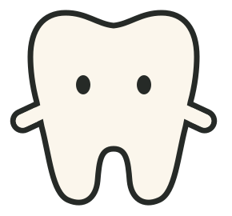
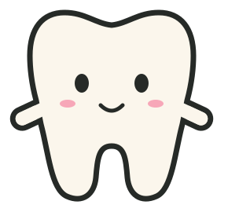
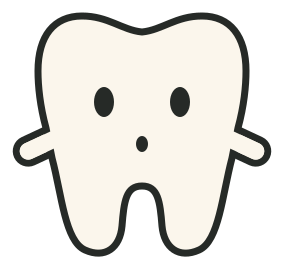
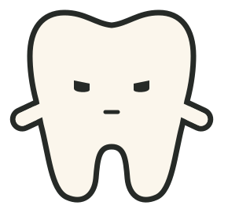
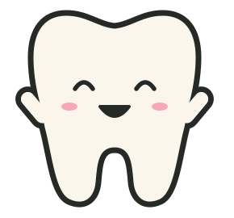
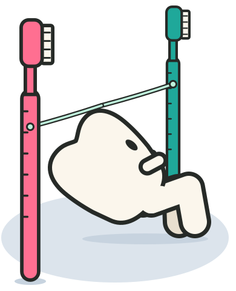
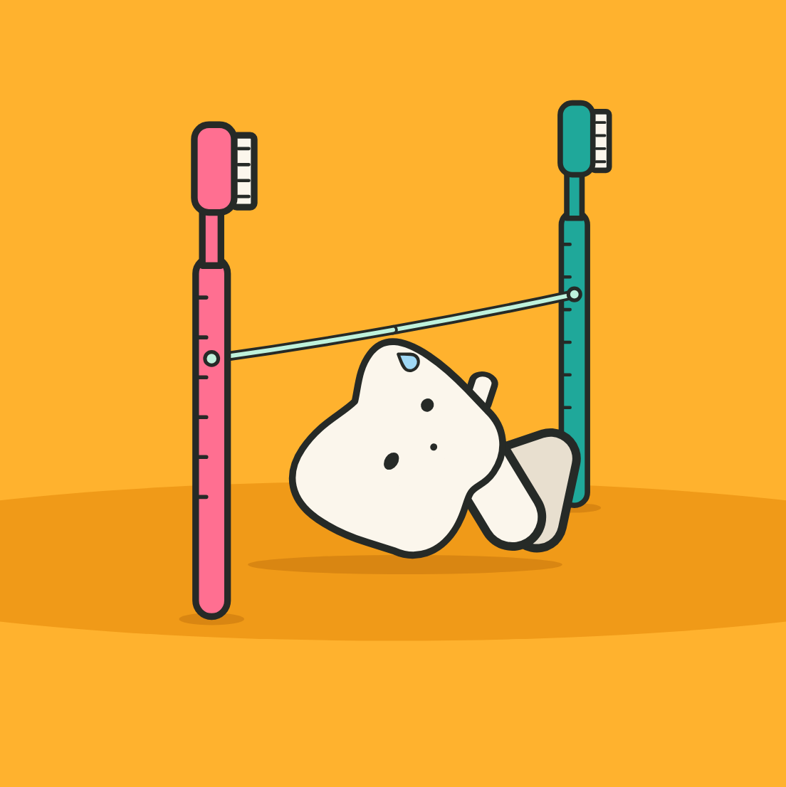

# Floss Tooth model sheet

The character bible for the tooth in the Floss Party animations, carried over from the "Floss Tooth Model Sheet" design (September 2026). Use it to keep the tooth on model in any new animation or app screen.

## Turnaround

Height is 238 units in every view. Only the width changes as the tooth turns. Eyes, arms and root split stay on their lines (top of lobes, eye line, arm line, root split, ground).

| View | Angle · width | Notes |
|---|---|---|
| Front | 0° · W 208 | The hero view. Symmetric, eyes 76 apart, arms level on the arm line. |
| Three-quarter | 45° · W 190 | The dip slides toward the far side. The far eye narrows and hugs the edge. The far arm only peeks out. |
| Profile | 90° · W 154 | A shallow front-to-back dip. One eye near the front. The arm breaks the front edge. The far root peeks out behind, one tone darker. |
| Three-quarter back | 135° · W 190 | Mirror of the three-quarter with no face. The near arm swaps to the right. |
| Back | 180° · W 208 | The front silhouette with no face. Nothing added to the back. |

**Silhouette check.** Fill every view solid. If it still reads as this tooth with no face, the drawing is on model. The dip and the two round root tips carry it.

## Character rules

1. **The heart-dip crown.** Two soft lobes and a shallow dip, about 7% of the height. It is the signature. Keep a hint of it in every view, even profile, where it turns into a gentler front-to-back dip.
2. **Tall eyes, set wide.** Two solid ovals, 9 by 12, 76 apart, 90 units below the lobe tops. No pupils, shines or brows. Turning, the far eye narrows and slides toward the edge. In profile only one eye shows, near the front.
3. **A mouth only when needed.** The resting face has no mouth. A mouth appears for an expression and goes away after. Never draw teeth inside it.
4. **Nub arms.** Short rounded capsules on the arm line. No hands, no elbows. The near arm can break the silhouette; the far arm peeks out or hides.
5. **Roots are legs.** Two chubby roots with round tips, side by side from the front and overlapped in profile. They bend at a soft knee for anything athletic, like the limbo. The far root is one tone darker.
6. **One line, flat color.** A 7-unit ink outline everywhere, about 3% of body width. Enamel fill, no shading, no anatomy lines. Depth comes from overlap and the one far-limb tone.

**Off model:** pointed or tapering root tips; pupils, eye shines or eyebrows; teeth inside the mouth; shading, gradients or enamel detail lines; thin or varying line weight; a face or extra detail on the back view.

## Expressions

Five faces, same two eyes. Change the eye shape and add a mouth. Never move the eyes off the eye line.

| Resting | Happy | Surprised | Focused | Delighted |
|---|---|---|---|---|
|  |  |  |  |  |
| Eyes only. The default face. | Small smile and blush. The everyday mood. | Eyes grow a little, small o mouth. The hat drop, the hoop catch. | Eyes flatten on top, short straight mouth. The limbo approach. | Eyes close into arcs, open smile, arms up. The payoff at the end of a loop. |

## Limbo pose study

| Profile (set aside) | Three-quarter (chosen) |
|---|---|
|  |  |
| The staging works, but one narrow eye points at the ceiling and the heart dip flattens out. | Both eyes stay on the floss, the root legs separate, and the near knee pushes toward us. |

The staging stays the same: brushes in depth, teal behind the tooth and pink in front, with the floss crossing the tooth's path just above the crown. The tooth walks through it turned three-quarters toward the camera.

To go under, the hips drop and the knees push forward while the shins stay under them. The pelvis stays nearly level; the arch happens above it, with the crown tipping back and squashing a little, so a rigid tooth still reads as an arch. Knees never fold up and out. Cap the lean near 55°: past that the crown turns into a flat shell with legs poking out from under it. Go lower by dropping the hips and squashing the crown, not by leaning further.

The face stays locked to the crown and tips with it. As the crown arches back, the face shortens along the crown's up-down axis and slides toward the top. Pass one uses the Focused face; the deep pass adds a small o and a sweat drop. The near arm tucks away during the arch (on the underside any angle reads as a third foot); the far arm stays up for balance. The camera sits low, so the floor is a thin ellipse and the gap under the floss feels tight.

## Palette

| Swatch | Name | Use |
|---|---|---|
| `#FBF6EC` | Enamel | Body fill |
| `#262A27` | Ink | Outline, eyes, mouth |
| `#E8DFCF` | Far limb | Root or arm on the far side |
| `#F7A7B8` | Blush | Cheeks, happy faces only |
| `#BFF2DC` | Floss mint | Every floss prop, ink-outlined |

One flat background per piece: Coral `#F26B50` (Floss Lasso), Cornflower `#4C86F0` (Floss Hoop), Marigold `#FFB22E` (Floss Limbo), Midnight plum `#4A2D6B` (Floss-o'-Lantern).
